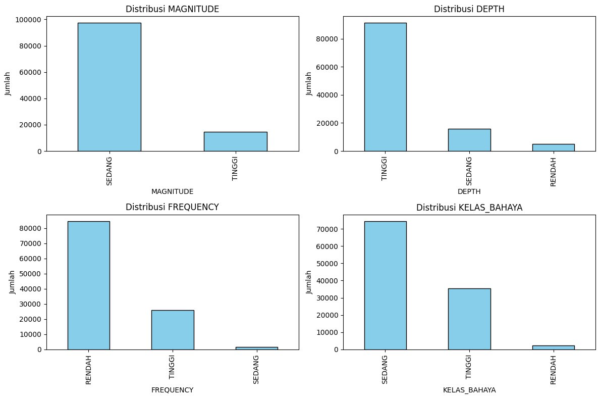

# Skoring Bahaya Gempa Global (GeoPandas)

Klasifikasi tingkat bahaya gempa signifikan dunia berdasarkan magnitudo, kedalaman, dan frekuensi kejadian per lokasi, menggunakan GeoPandas.

Tugas 6 bootcamp WebGIS Developer (Working with Spatial Data).

## Metode

1. Muat dataset *Significant Earthquakes* (Kaggle) dan ubah ke GeoDataFrame (EPSG:4326).
2. Buat zona bahaya dengan buffer 100 km (dihitung di EPSG:3857).
3. Klasifikasi tiap parameter menjadi skor 1–3:

| Parameter | Tinggi (3) | Sedang (2) | Rendah (1) |
|---|---|---|---|
| Magnitudo | ≥ 6 | 5–6 | < 5 |
| Kedalaman | ≤ 70 km (dangkal) | 70–300 km | > 300 km |
| Frekuensi per `place` | ≥ 50 | 20–49 | < 20 |

4. Jumlahkan skor (3–9), lalu kelaskan: Rendah (≤ 4), Sedang (5–6), Tinggi (7–9).
5. Ekspor ke `earthquake_risk_final.geojson`.

## Hasil

| Kelas bahaya | Rata-rata skor |
|---|---|
| Rendah | 4,0 |
| Sedang | 5,8 |
| Tinggi | 7,7 |

## Isi repo

| File | Isi |
|---|---|
| `Task Day 6.ipynb` | Notebook analisis |
| `significant-earthquakes-metadata.json` | Metadata dataset Kaggle |

Dataset CSV tidak disertakan. Unduh dari Kaggle (*Significant Earthquakes*) dan sesuaikan path di notebook.

## Tools

Python · GeoPandas · pandas · Matplotlib

## Penulis

**Arsya Dika** · [GitHub](https://github.com/ArsyaDika)
